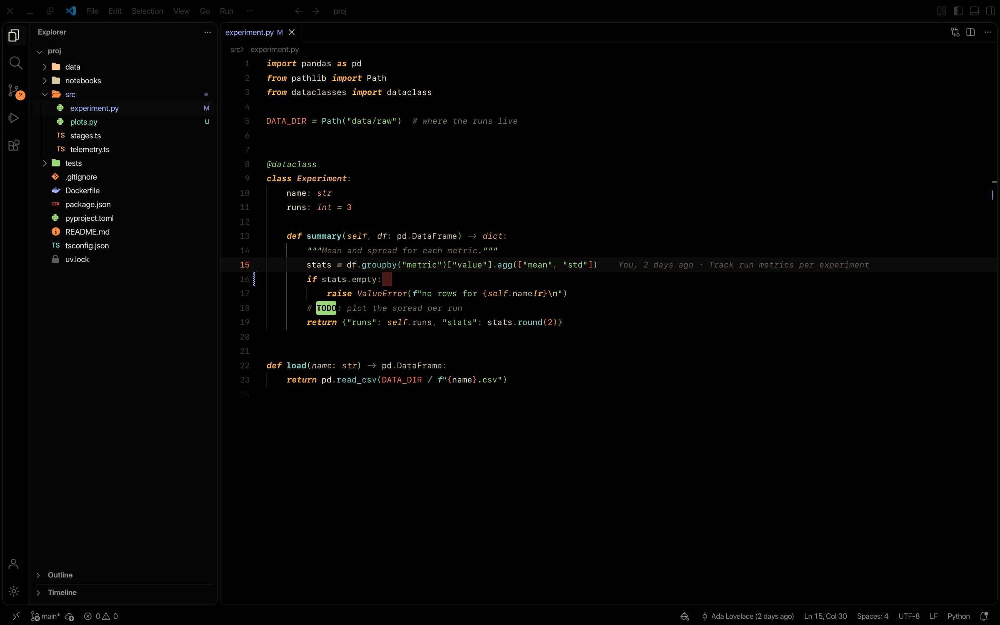
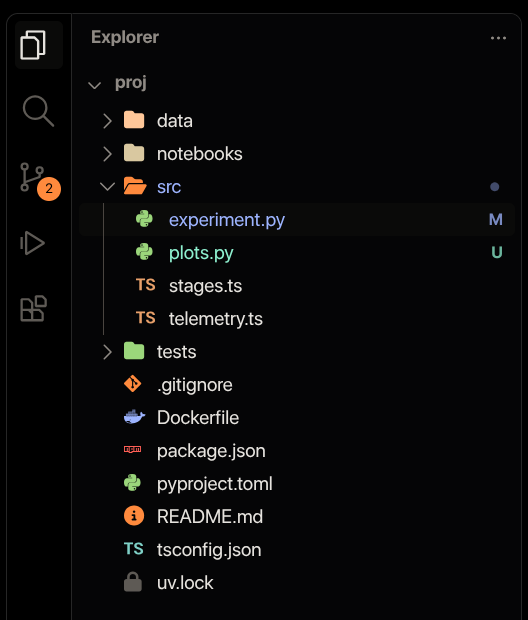
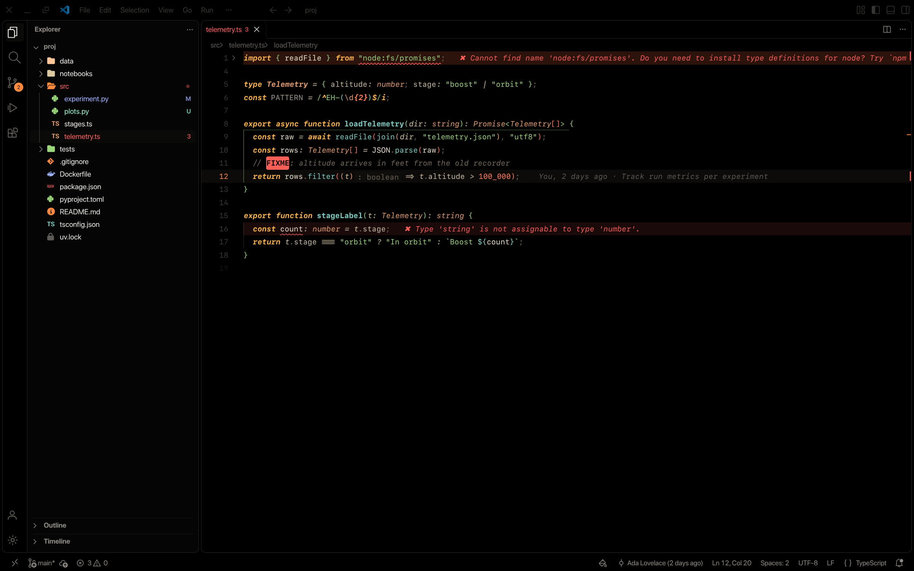
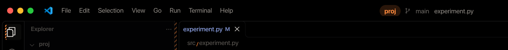
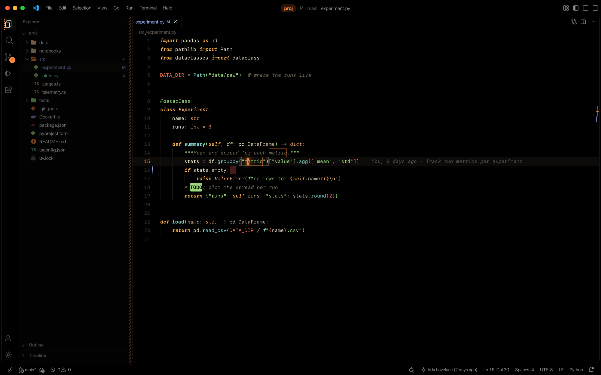

# Event Horizon Deep Space Theme

A true-black theme for VS Code. Almost nothing glows except an accretion-orange accent and an amber-phosphor syntax
palette, like the instrument panels of a ship in deep space. It comes with matching file icons, a chamfered product icon
set, and a few small editor features.



## What's inside

**Color theme: Event Horizon Deep Space**
- True `#000` editor, made for OLED screens, with panels separated by hairlines.
- Orange accent for the cursor, selection, find matches, focus and the active line number.
- Mission Phosphor syntax: amber keywords, terminal-green strings, instrument-teal functions, copper types and
  warning-orange numbers on warm paper-white code. Keywords are bold italic; functions and classes are bold where they're
  defined and regular where they're used.
- Colored regex parts and log files, palette bracket pairs, quiet scrollbars and breadcrumbs, and a terminal that matches
  the editor. Every syntax color meets 4.5:1 contrast on black (comments 3.5:1).

**Icons**
- **Event Horizon Nerd**: file icons from Nerd Fonts glyphs (the same logos your terminal shows), in the theme's colors.
- **Event Horizon Tiles**: language marks on soft colored squares, if you prefer flat badges.
- **Event Horizon Hull**: a product icon set of 24 thin, chamfered line icons for the activity bar, explorer toolbar,
  status bar, tree arrows and tab buttons. Everything it doesn't cover falls back to VS Code's own icons.



**Editor features**
- **Comment tags**: TODO, FIXME, NOTE and HACK (plus BUG and XXX) become colored pills inside comments.
- **Inline problems**: the error or warning message at the end of its line, with a soft tint on error lines.
- **Git blame**: who last changed the current line, when, and why, in faint text at the end of the line. It only runs
  in trusted workspaces, with git's repository-configured commands (fsmonitor, textconv) switched off.
- **Folded-line counts**: a folded block shows how many lines it hides.
- **Trailing whitespace**: tinted, except on the line you're typing in.



## Get started

1. Install the extension.
2. Run **Event Horizon: Apply Setup** from the command palette. It asks first, then sets the theme, both icon themes,
   line height 1.8, a 4px cursor with expand blink, hairline indent guides, bracket pair guides, sticky scroll, minimap
   off, quiet scrollbars, inlay hints and a few more. **Event Horizon: Revert Setup** puts your previous values back.

Or pick them yourself: **Preferences: Color Theme** → Event Horizon Deep Space, **File Icon Theme** → Event Horizon Nerd,
**Product Icon Theme** → Event Horizon Hull.

The theme looks best with a font that has good italics. It was designed with SF Mono at line height 1.8.

## Settings

| Setting | Default | |
|---|---|---|
| `eventHorizon.commentTags.enabled` | `true` | Comment-tag pills |
| `eventHorizon.inlineProblems.enabled` | `true` | Messages at the end of the line |
| `eventHorizon.inlineProblems.minSeverity` | `warning` | `error`, `warning`, `info` or `hint` |
| `eventHorizon.blame.enabled` | `true` | Git blame on the current line |
| `eventHorizon.foldedLines.enabled` | `true` | Hidden-line counts on folded blocks |
| `eventHorizon.trailingWhitespace.enabled` | `true` | Tint trailing spaces and tabs |
| `eventHorizon.indentColumns.enabled` | `false` | Tinted columns instead of hairline indent guides |

All the extension's colors are theme colors (`eventHorizon.*`), so you can override them in `workbench.colorCustomizations`.

## Optional extras (custom CSS)

Some details are beyond what a VS Code theme can do: hazard-stripe tabs, a hatched seam between the files and the code,
slash breadcrumbs, a cursor glow, an accretion ring in the empty editor, macOS traffic lights and a project chip in the
title bar.



They ship as an optional stylesheet and script, and they need the
[Custom CSS and JS Loader](https://marketplace.visualstudio.com/items?itemName=be5invis.vscode-custom-css) extension.
**That loader modifies VS Code's own files**: VS Code will report a "corrupt installation", and you have to re-enable it
after every VS Code update. On Linux it also needs write access to VS Code's install folder. Only use it if you're
comfortable with that.

1. Install the Custom CSS and JS Loader.
2. Run **Event Horizon: Copy Custom CSS Setting** and paste the copied line into your `settings.json`.
3. For the title bar extras, also add:
   ```json
   "window.controlsStyle": "custom",
   "window.title": "${rootName} @ ${activeRepositoryBranchName} / ${activeEditorShort}",
   "workbench.navigationControl.enabled": false
   ```
4. Run **Enable Custom CSS and JS** and restart VS Code.



## Build from source

```sh
npm run build    # theme, icon themes and colors from src/palette.js
npm run fonts    # build + the two icon fonts (needs uv)
npm test
npx @vscode/vsce package
```

`src/palette.js` is the single source of truth for every color.

## Credits

File icons are a subset of [Symbols Nerd Font](https://github.com/ryanoasis/nerd-fonts) (MIT), which collects glyphs from
Devicons, Seti-UI, Font Awesome, Octicons and Font Logos. See [THIRD_PARTY_NOTICES.md](THIRD_PARTY_NOTICES.md).
The Hull and Tiles icons are original. Released under the [MIT License](LICENSE).
